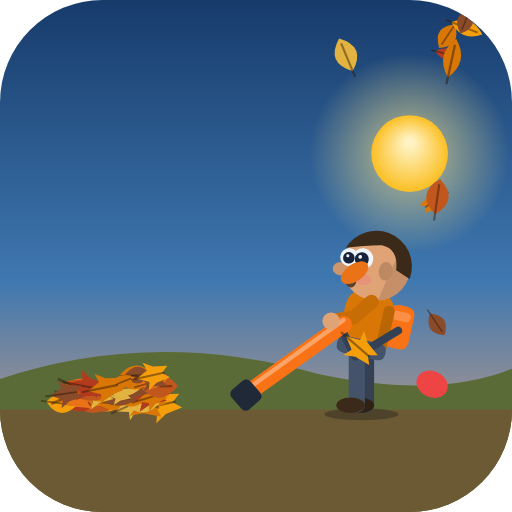
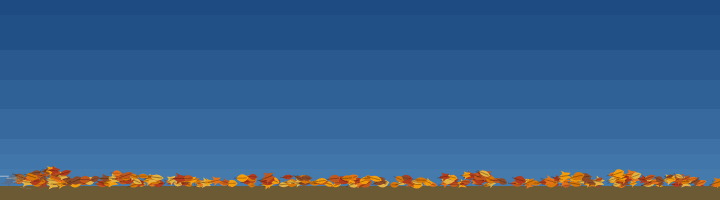
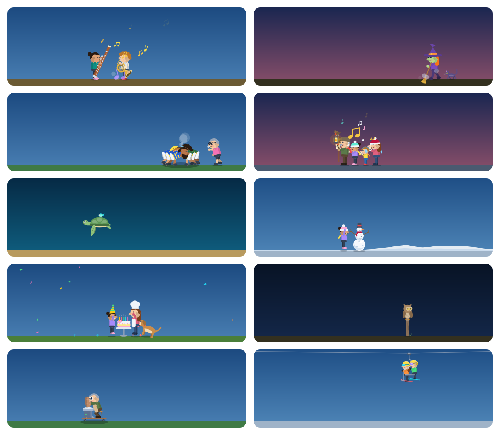

<p align="center">
  
</p>

<h1 align="center">Seasonal Scenes</h1>

<p align="center">
  Little animated characters that wander across your Home Assistant dashboard<br>
  and act out the season, the time of day, the holidays and your family's birthdays.
</p>

<p align="center">
  <a href="https://hacs.xyz"></a>
  <a href="https://github.com/colegates/seasonal-scenes/releases"></a>
  <a href="https://github.com/colegates/seasonal-scenes/actions/workflows/validate.yml"></a>
</p>



In autumn the leaves fall and pile up along the bottom of the card, until a
little man with a leaf blower turns up to clear them (and gets a face full of
leaves for his trouble). In winter it snows and someone builds a snowman. On a
birthday a little plane tows a banner with the birthday person's name on it and
a chef wheels out a cake. After dark
an owl blinks on a post and a sleepwalker drifts past in his nightcap.

It is decoration, nothing more, built to delight children watching a kitchen
wall panel and to stay out of everyone else's way: the characters keep to the
bottom of the screen, the weather is light, and the whole thing sleeps when
nothing is moving.

## What's in it

**113 short acts in 19 themes**, each with a beginning, a gag and an exit, and
random variations so the same act is rarely the same twice.



| | Themes |
|---|---|
| **Seasons** | Autumn leaves, winter snow, spring blossom, summer. Real snow outside (from your weather entity) turns any theme wintry. |
| **Time of day** | The sky in the card follows the clock, from dawn through to night. After dark a slower night-time cast takes over. |
| **Holidays** | New Year, Valentine's Day, Pancake Day, Easter, Halloween, Bonfire Night, Christmas (building up through Advent) and New Year's Eve. |
| **Birthdays** | On someone's birthday the scenes are mostly about them, by name. The evening before, someone tiptoes past with a present behind their back. |
| **Hobbies** | Golf, rugby, French horn and bassoon, pottery, skiing and scuba diving. Switch off the ones that are not your family's. |
| **The house** | Bins going out the night before collection, umbrellas when it rains, the paper round, a dog with a stick. |

A theme gets the stage for 20 minutes at a time. The choice is seeded by the
date, so every screen in the house shows the same theme at the same moment.

## Install

### Marketplace or HACS (recommended)

From Home Assistant 2026.11, HACS is built in as the **Marketplace**
(**Settings → Marketplace**). On older versions, use HACS. The steps are the
same in both:

[](https://my.home-assistant.io/redirect/hacs_repository/?owner=colegates&repository=seasonal-scenes&category=plugin)

Or by hand:

1. Open the Marketplace (or HACS), open the menu (top right) and choose **Custom repositories**.
2. Add `https://github.com/colegates/seasonal-scenes` with type **Dashboard**.
3. Find **Seasonal Scenes**, download it, and reload your browser.

### Manually

1. Download `seasonal-scenes.js` from the [latest release](https://github.com/colegates/seasonal-scenes/releases/latest).
2. Copy it to `config/www/seasonal-scenes.js`.
3. In **Settings → Dashboards → ⋮ → Resources**, add `/local/seasonal-scenes.js` as a **JavaScript module**.

## Use it

Edit a dashboard, add a card and search for **Seasonal Scenes**. Everything
below can be set in the visual editor, apart from bins and boosts, which need
YAML.

The simplest version is a card:

```yaml
type: custom:seasonal-scenes-card
```

Or let the characters walk along the bottom of the whole dashboard. The card
itself disappears (it shows a small placeholder in edit mode) and the scene
plays over the bottom of the view, without getting in the way of a single tap:

```yaml
type: custom:seasonal-scenes-card
mode: overlay
```

Overlay mode draws on a transparent layer, so it looks best on a dark theme.

### A fuller example

```yaml
type: custom:seasonal-scenes-card
height: 260
hobbies: [golf, pottery, skiing]
birthdays: Ada:03-14;Ben:11-02
birthdays_entity: input_text.family_birthdays
weather_entity: weather.home
bins:
  domestic: sensor.general_waste_collection
  recycling: sensor.recycling_collection
boost:
  pottery: binary_sensor.kiln_firing
  skiing: input_boolean.ski_trip
```

### Options

| Option | Default | |
|---|---|---|
| `mode` | `card` | `card` plays in its own card. `overlay` plays along the bottom of the whole dashboard. |
| `height` | `240` | Card height in pixels (card mode). |
| `background` | `sky` | `sky` follows the time of day, with a strip of ground that follows the season (and turns to sea for scuba). `card` uses your theme's card colour, `none` is transparent, or give any CSS background. |
| `ground` | `true` | Draw the strip of ground under the cast in `sky` mode. |
| `scale` | `1` | Make every character bigger or smaller. |
| `calm` | `false` | Fewer acts and lighter weather. |
| `hobbies` | all | Which hobby themes to include: `golf`, `rugby`, `music`, `pottery`, `skiing`, `scuba`. |
| `holidays` | all | Which holidays to celebrate: `newyear`, `valentines`, `pancake`, `easter`, `halloween`, `bonfire`, `christmas`, `newyearseve`. Bonfire Night is on by default only if your Home Assistant country is the UK or New Zealand. |
| `birthdays` | | `Name:MM-DD` separated by semicolons, or a list of `{ name, date }`. |
| `birthdays_entity` | | A text helper holding birthdays in the same `Name:MM-DD;...` format, so they can be changed from a dashboard. Used together with `birthdays`. |
| `weather_entity` | first weather entity | For rain and real snow. `false` to ignore the weather. |
| `bins` | | Bin collection entities by kind (`domestic`, `recycling`, `food`). Each can be on/off, a number of days until collection, or a date. From 3pm the day before collection until 9am on the day, someone wheels the right bin out. |
| `boost` | | Theme → entity. While the entity is on, that theme takes the stage far more often, even out of season (but never at night). Boosting `pottery` also brings on the kiln-firing act. |
| `hemisphere` | from your latitude | `north` or `south`. In the south the seasons swap round; Christmas stays in December. |
| `time_zone` | Home Assistant's | Any IANA zone, e.g. `Europe/London`. |
| `preview_theme` | | Play one theme's acts back to back, to see them all. Remove it when you are done. |
| `tap_to_play` | `true` | Tapping the card brings the next act on straight away. Children work this out fast. |
| `respect_reduced_motion` | `true` | Hide the animation on devices set to reduce motion. |
| `overlay_offset` | `0` | Overlay mode: pixels to leave clear at the bottom, for a bottom nav bar. |
| `overlay_z_index` | `3` | Overlay mode: stacking order. The default sits above your cards and below the header and dialogs. |

### Birthdays from a dashboard

Put the birthdays in a text helper and anyone can edit them without opening the
card editor:

```yaml
# configuration.yaml
input_text:
  family_birthdays:
    name: Family birthdays
    max: 255
```

Set it to something like `Ada:03-14;Ben:11-02;Grandma:07-30`. Someone born on
29 February gets their day on the 28th in other years.

## Kind to your devices

- Plain 2D canvas, no images and no libraries: about 160 KB over the wire.
  It runs happily on old Android wall panels.
- It draws at 30 frames a second while an act is on, 20 while only the
  weather moves, and **not at all** in between: it paints the resting pile once
  and sleeps until the next act or flurry is due.
- It stops while the browser tab is hidden or the card is scrolled out of view.
- It never catches a tap in overlay mode, and it is hidden from screen readers.

## Make your own acts

Every act is a small TypeScript object with `create`, `update` and `draw`.
There's a character rig, props, animals and a particle system to build
with, plus tools that render an act to a contact sheet and check that it
behaves. See [CONTRIBUTING.md](CONTRIBUTING.md). New themes, holidays from
other countries and new hobbies are all very welcome.

## Credits

Drawn in code, one act at a time, for a family in England who like golf, rugby,
the French horn, the bassoon, pottery, skiing and scuba diving. Inspired by the
animated dashboards of [OhMyHA Studio](https://ohmyha.com/studio).

Licensed under the [GNU GPL v3](LICENSE).
